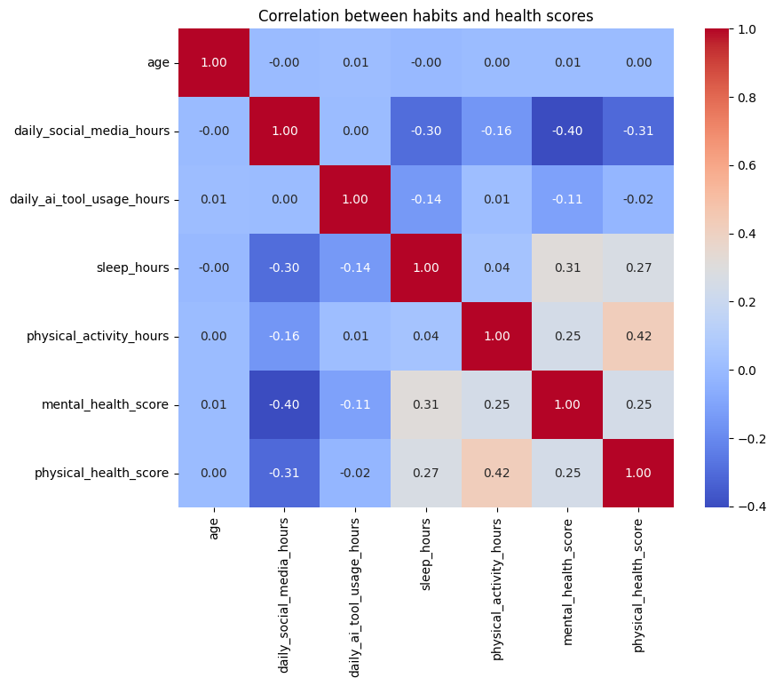
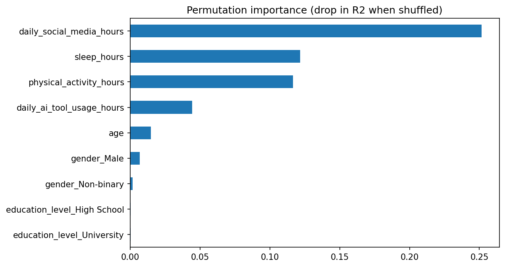

# AI & Social Media Impact on Student Health

An exploratory data analysis and prediction project on how daily social media use, AI tool use, sleep, and physical activity relate to student mental and physical health scores.

## Question
How are social media use, AI tool use, sleep, and physical activity associated with student mental and physical health scores?

## Dataset
[AI & Social Media Impact: Student Health & Grades]([paste your Kaggle link here]), 16,000 student records with 10 columns.

**The dataset is synthetic.** Findings describe patterns in simulated data, not real students.

## Key Findings
- **Social media use had the strongest association with mental health score** (r = -0.40). Students in the highest-usage third averaged 68.2, compared with 76.5 in the lowest-usage third, about 8 points lower.
- **Sleep (r = +0.31) and physical activity (r = +0.25)** were positively associated with mental health score.
- **AI tool use had only a weak association** (r = -0.11). High AI users averaged 71.4 vs. 73.6 for low users, about 2 points lower.
- **Physical health score** was most strongly linked to physical activity (r = +0.42).
- **Age, gender, and education level** showed almost no relationship with mental health score.

## Models
I predicted mental health score from age, gender, education level, and the four daily habits, using an 80/20 train/test split.

| Model | R2 | MAE |
|---|---|---|
| Linear Regression | 0.238 | 6.33 |
| Random Forest | 0.251 | 6.17 |

Both models explain about a quarter of the variation in scores, and the random forest is only slightly better than the linear model. This fits the moderate correlations above.

### Feature importance
The random forest's built-in importance ranked AI tool use and age higher than their correlations suggested, so I checked it with permutation importance. The permutation results (below) match the correlations: social media matters most, sleep and physical activity come next, AI tool use has a small effect, and age, gender, and education level contribute almost nothing.

## Limitations
- The dataset is synthetic and cleaner than real-world data: no missing values, and ages line up perfectly with education levels.
- Several columns have spikes at exactly 0 hours and physical health scores pile up near 100, which suggests values were clipped when the data was generated.
- Correlation does not imply causation.
- Predictive power is modest (R2 about 0.25), so most variation between students is not explained by these variables.

## How to Run
1. Download the dataset from the Kaggle link above.
2. Open `analysis.ipynb` and click **Open in Colab**.
3. Upload the CSV to Colab and update the file path in the first code cell.
4. Run all cells (**Runtime > Run all**).

## Tools
Python, pandas, matplotlib, seaborn, scikit-learn
